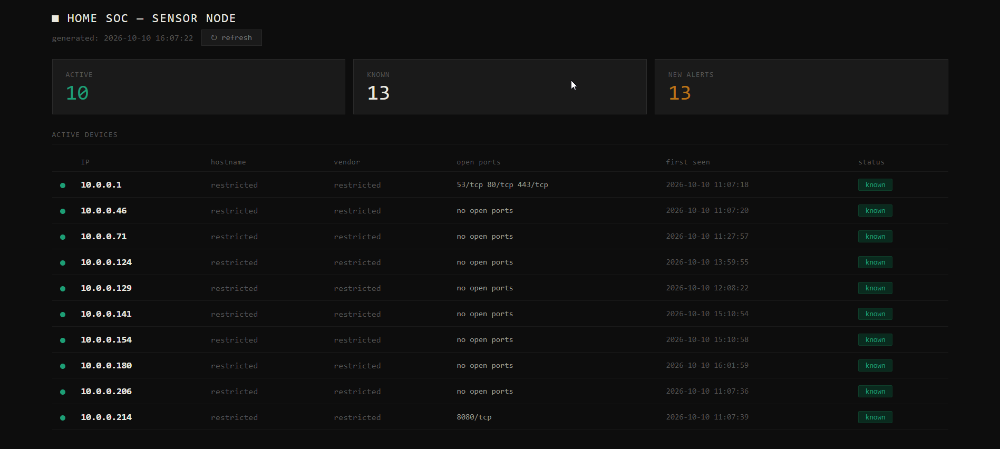

# Mini Home SOC — Android Network Sensor + Dashboard



A lightweight Security Operations Center built on a repurposed Android phone running 24/7 as a home network sensor. Monitors devices, detects new connections, scans ports, and serves a responsive dashboard accessible from anywhere via Tailscale.

Originally built on a ZTE Blade L210 (256MB RAM), now running on a Samsung Galaxy S10. No root required on either device.

---

## What it does

- Discovers all devices on the home network every 10 minutes
- Fingerprints every new device — IP, open ports, first seen timestamp
- Scans security-critical ports across the entire network every hour
- Alerts on new unknown devices joining the network
- Generates hourly reports summarizing network state
- Serves a responsive dark-theme dashboard over a zero-trust private network

---

## Architecture

```
Internet
    │
    │
┌─────────────┐
│  Tailscale  │
│ private net │
└──────┬──────┘
       │
┌──────┼──────────────┐
│      │              │
Laptop  Main Phone   Sensor Phone (Samsung S10)
                      Tailscale Android app
                           │
                 ┌─────────────────┐
                 │  SOC Dashboard  │
                 │  Static HTML    │
                 │  python http    │
                 └────────┬────────┘
                          │
                  ┌───────────────┐
                  │  Monitoring   │
                  │  Scripts      │
                  │  nmap scans   │
                  └───────────────┘
```

---

## Hardware

| | Current | Original |
|---|---|---|
| Device | Samsung Galaxy S10 (SM-G973W) | ZTE Blade L210 |
| Chip / RAM | Snapdragon 855, 8GB | ARMv7, 256MB |
| OS | Android 12 | Android 10 Go Edition |
| Root | No | No |
| Runtime | Termux | Termux |
| Remote access | Tailscale Android app | Tailscale 1.32.3 in Termux (userspace mode) |
| Network | Home Wi-Fi (wlan0) | Home Wi-Fi (wlan0) |

---

## Stack

- Android + Termux
- Bash scripting
- nmap
- iproute2 (network range detection)
- Python http.server
- Tailscale (WireGuard)
- HTML / CSS
- tmux

---

## Folder Structure

```
~/soc/
├── scripts/
│   ├── device_monitor.sh       # discovery scan every 10 min
│   ├── device_profile.sh       # fingerprints new devices
│   ├── scan_detector.sh        # port scan every 1 hour
│   ├── report_builder.sh       # builds hourly text report
│   ├── hourly_reporter.sh      # runs report builder loop
│   ├── gen_dashboard.sh        # generates static HTML dashboard
│   ├── start_dashboard.sh      # starts Python HTTP server
│   ├── start_tailscale.sh      # legacy: Termux Tailscale for older devices
│   └── start_soc.sh            # master launcher
├── logs/
│   ├── known_devices.txt
│   ├── current_devices.txt
│   ├── device_alerts.log
│   ├── device_profiles.log
│   ├── scan_activity.log
│   └── report_runner.log
├── profiles/                   # per-device profile files
├── reports/                    # hourly report files
└── www/
    └── index.html              # generated dashboard
```

---

## Setup Guide

### Step 1 — Prepare the phone

- Connect to your home Wi-Fi
- Set Termux battery usage to **Unrestricted** (Settings → Apps → Termux → Battery) so Android doesn't kill it overnight
- If the phone stays plugged in 24/7, turn on battery protection (Samsung: Settings → Battery → Protect battery)

### Step 2 — Install Termux

Install Termux from F-Droid (not Play Store — the Play Store version is abandoned):
```
https://f-droid.org/packages/com.termux/
```

### Step 3 — Install packages

```bash
pkg update && pkg upgrade -y
pkg install nmap python tmux curl git iproute2 -y
```

`iproute2` is required. The monitor and scanner use `ip route` to detect your network range. Without it, scans run with an empty target and find nothing.

### Step 4 — Get the scripts

```bash
mkdir -p ~/soc/{logs,profiles,reports,www}
git clone https://github.com/PathanZ/mini-home-soc.git ~/mini-home-soc
cp -r ~/mini-home-soc/scripts ~/soc/
chmod +x ~/soc/scripts/*.sh
```

If you copy scripts from a Windows machine instead, strip Windows line endings first:
```bash
sed -i 's/\r$//' ~/soc/scripts/*.sh
```

### Step 5 — Set up Tailscale

Install the **Tailscale** app from the Play Store, sign in, and tap Connect. No root and no Termux setup needed.

Note the phone's Tailscale IP (starts with `100.`) and add it to the launcher:
```bash
sed -i 's/CHANGE_ME/100.x.x.x/' ~/soc/scripts/start_soc.sh
```

In the Tailscale admin console, disable key expiry for the sensor so it doesn't drop off the network after 180 days.

### Step 6 — Add a shortcut (optional)

```bash
echo "alias soc='bash ~/soc/scripts/start_soc.sh'" >> ~/.bashrc
source ~/.bashrc
```

### Step 7 — Launch everything

```bash
soc
```

This starts 4 tmux windows:
- `monitor` — device discovery
- `scanner` — port scanning
- `reporter` — hourly reports
- `dashboard` — HTTP server on port 8080

### Step 8 — Access the dashboard

From any device on your Tailscale network:
```
http://<your-tailscale-ip>:8080
```

On the same local network:
```
http://<phone-local-ip>:8080
```

The first discovery scan takes a minute or two. Refresh the page after that.

### Step 9 — Backfill device profiles

On first run, profile all already-known devices:

```bash
while read -r ip; do
  bash ~/soc/scripts/device_profile.sh "$ip"
done < ~/soc/logs/known_devices.txt

bash ~/soc/scripts/gen_dashboard.sh
```

---

## After a reboot

```bash
soc
```

---

## Older devices (legacy Tailscale in Termux)

The original ZTE Blade L210 runs kernel 4.14, which blocks syscalls used by newer Tailscale versions, and the Tailscale app was too heavy for 256MB RAM. On devices like that, run Tailscale 1.32.3 inside Termux in userspace-networking mode:

```bash
cd ~
wget https://pkgs.tailscale.com/stable/tailscale_1.32.3_arm.tgz
tar -xzf tailscale_1.32.3_arm.tgz
cd tailscale_1.32.3_arm
cp tailscale tailscaled $PREFIX/bin/
chmod +x $PREFIX/bin/tailscale $PREFIX/bin/tailscaled
mkdir -p ~/tailscale-state

tailscaled --tun=userspace-networking \
           --state=$HOME/tailscale-state/tailscaled.state \
           --socket=$TMPDIR/tailscaled.sock
```

Then in a second session:
```bash
tailscale --socket=$TMPDIR/tailscaled.sock up
```

`start_tailscale.sh` wraps this. Add it back as a tmux window in `start_soc.sh` if you use this route.

---

## Troubleshooting

**Dashboard shows 0 devices / scan log says `Failed to resolve ""`:**
`iproute2` is missing, so the network range can't be detected.
```bash
pkg install iproute2 -y
soc
```

**`soc: command not found`:**
The current Termux window hasn't loaded the shortcut yet.
```bash
source ~/.bashrc
```

**Port 8080 already in use:**
```bash
pkill -9 -f "python"
sleep 2
bash ~/soc/scripts/start_dashboard.sh
```

**Scripts stop running after a while (Android 12+):**
Android's phantom process killer may be stopping background processes. Disable it from a computer with adb:
```bash
adb shell device_config put activity_manager max_phantom_processes 2147483647
```

**Check all tmux windows:**
```bash
tmux attach -t soc
# Ctrl+B then W to list windows
# Ctrl+B then D to detach
```

---

## Key Design Decisions

| Decision | Reason |
|----------|--------|
| Static HTML instead of Flask | Built for 256MB RAM; still lighter on battery on the S10 |
| Python http.server | Zero extra dependencies |
| Tailscale Android app (S10) | No root needed, full TUN mode, no Termux workaround |
| Tailscale 1.32.3 userspace (ZTE) | Kernel 4.14 blocks syscalls used by newer versions; no TUN without root |
| bash scripts instead of Python | Minimal memory footprint |
| No database | Flat log files sufficient, lighter on storage |
| No auto-refresh | Manual refresh saves CPU |
| No root | Locked bootloader on Canadian Snapdragon S10; project stays reproducible on stock phones |

---

## Security concepts demonstrated

- Network monitoring
- Asset discovery
- Device fingerprinting
- Threat detection
- Zero-trust networking (Tailscale / WireGuard)
- Security automation
- SOC sensor architecture
- Secure remote access without port forwarding

---

## Limitations

- Hostname, vendor and MAC address not available without root (Android restricts ARP table access)
- Device names can be matched manually from the router's admin page
- Phone runs warm under continuous load — keep ventilated

---

## License

[MIT](LICENSE)
